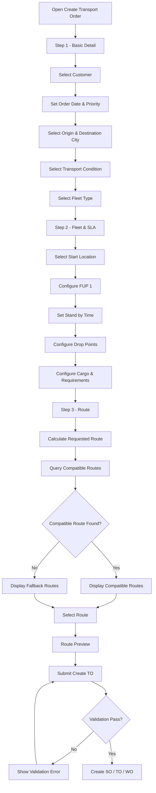
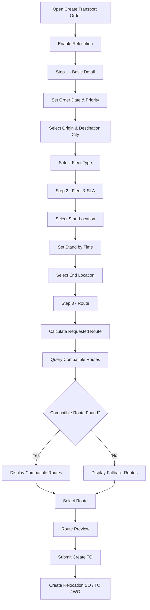
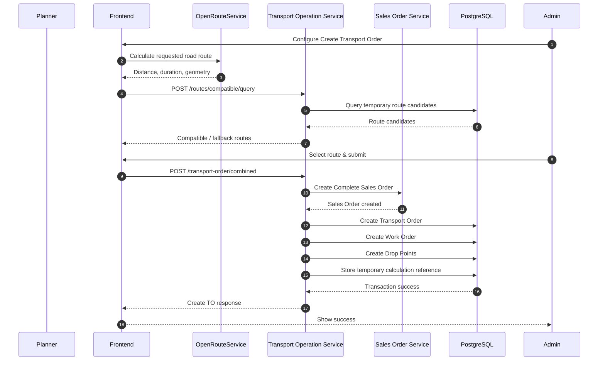

# 9\. AC-TO-01 Create TO Revamp

## 9.1 UI Layout

### Normal Mode

Page: **Create Transport Order**

https://www.figma.com/design/RhQBQWNRp0Z6ljrh6TxbJQ/TCL---TMS-V.2--Project-s-Version-?node-id=12802-15960&t=mCWVDbUM0qFw8acS-4

Create Transport Order consists of 3 steps:

**Step 1 — Basic Detail**

- Customer
- Relocation
- Order Date
- Priority
- Route
  - Origin City
  - Destination City
- Transport Condition
  - Frozen
  - Dry
- Fleet Type

**Step 2 — Fleet & SLA**

- Start Location
- FUP 1
  - Route & SLA
  - Stand by Time
  - Drop Point(s)
  - Product Group
  - Requirements
  - Fleet Notes
  - Optional relocation before pickup
  - Optional relocation after last drop

**Step 3 — Route**

- Route candidate list
- Compatible route
- Fallback route
- Route preview
- Select route

---

### Relocation Mode

Page: **Create Transport Order**

https://www.figma.com/design/RhQBQWNRp0Z6ljrh6TxbJQ/TCL---TMS-V.2--Project-s-Version-?node-id=12858-8930&t=mCWVDbUM0qFw8acS-4

Relocation mode uses the same Create Transport Order flow with simplified Fleet & SLA configuration.

**Step 1 — Basic Detail**

- Customer becomes optional
- Relocation enabled
- Order Date
- Priority
- Origin City
- Destination City
- Fleet Type

**Step 2 — Fleet & SLA**

- Start Location
- FUP 1
  - Route & SLA
  - Stand by Time
  - End Location

Cargo, Requirements, normal Drop Points, and leading/trailing relocation controls are not displayed in relocation mode.

**Step 3 — Route**

- Route candidate list
- Compatible movement route
- Fallback movement route
- Route preview
- Select route

## 9.2 UI Components & Test IDs

| Component | Test ID |
| --- | --- |
| Customer field | `field-customer` |
| Relocation switch | `switch-relocation-mode` |
| Order Date field | `field-order-date` |
| Priority switch | `switch-priority-basic-detail` |
| Origin City field | `field-origin-city` |
| Destination City field | `field-destination-city` |
| Transport Condition field | `field-transport-condition` |
| Fleet Type field | `field-fleet-type` |
| Start Location field | `field-pickup-location` |
| Stand by Time field | `field-standby-time` |
| End Location field | `field-drop-point-1` |
| Leading Relocation switch | `switch-leading-relocation` |
| Has Deadline switch | `switch-has-deadline-{sequence}` |
| Trailing Relocation switch | `switch-trailing-relocation` |
| FUP expansion button | `btn-toggle-fup-expansion` |

## 9.3 Interaction Flow

### Create TO — Normal Mode



### Create TO — Relocation Mode



## 9.4 UI Functions

| Component | Function | Result |
| --- | --- | --- |
| **Relocation Switch** | Change Create TO mode | Switches between normal delivery and movement-only flow. |
| **Transport Condition** | Select Frozen / Dry | Controls temperature validation and Freezer requirement. |
| **Origin/Destination** | Select route cities | Used for route and location validation. |
| **Start Location** | Select pickup / movement start | Used as the first route coordinate. |
| **Drop Point** | Add delivery location | Adds an actual delivery stop to the route. |
| **Has Deadline** | Enable/disable deadline per drop | Enables or clears `requested_time`. |
| **Need Relocation** | Add movement before/after delivery | Adds a movement stop at the beginning or end of the sequence. |
| **Select Route** | Select calculated route | Stores the selected temporary calculation for Create TO. |

## 9.5 Validation Rules

| Field / Validation | Rule |
| --- | --- |
| **Customer** | Required when Relocation is OFF. |
| **Order Date** | Required. |
| **Origin City** | Required. |
| **Destination City** | Required. |
| **Transport Condition** | Required. Values: `Frozen` or `Dry`. |
| **Fleet Type** | Required. |
| **Start Location** | Required. |
| **Stand by Time** | Required and must use the same date as Order Date. |
| **Drop Point** | At least one actual drop is required in normal mode. |
| **Product Group** | At least one product group is required in normal mode. |
| **Relocation Movement** | Movement is allowed only before pickup or after the last actual drop. |
| **Middle Movement** | Movement between actual delivery drops is not allowed. |
| **Relocation Mode** | Start Location, Stand by Time, and End Location are required. Customer and cargo are not required. |
| **Frozen Temperature** | Temperature must be between `-22°C` and `-18°C`. |
| **Dry Temperature** | Temperature must be between `-17°C` and `15°C`. |
| **Frozen Requirement** | Selecting Frozen automatically adds `Freezer` to Requirements. |
| **Has Deadline OFF** | `requested_time` is empty/null. |
| **Has Deadline ON** | `requested_time` contains the selected RFC3339 datetime. |
| **Start City** | Must match the city of the Start/Pickup Location. |
| **End City** | Must match the city of the last actual drop in normal mode or End Location in relocation mode. |

## 9.6 State Handling

| State | Behavior |
| --- | --- |
| **Relocation OFF** | Standard delivery Create TO flow is displayed. |
| **Relocation ON** | Customer becomes optional and Step 2 changes to Start Movement → End Movement. |
| **Frozen** | `Freezer` is automatically selected in Requirements. |
| **Dry** | `Freezer` is removed while other requirements remain unchanged. |
| **Has Deadline ON** | Deadline date/time can be selected for the specific drop. |
| **Has Deadline OFF** | Existing deadline for that drop is cleared. |
| **Leading Relocation ON** | Movement point is added before pickup. |
| **Trailing Relocation ON** | Movement point is added after the last drop. |
| **Middle Movement** | Invalid state. |
| **FUP Expanded** | FUP 1 configuration is displayed. |
| **FUP Collapsed** | FUP 1 configuration is hidden while Start Location remains visible. |
| **Validation Error** | Invalid fields remain on the current step and display validation feedback. |

## 9.7 API Spec

## Query Compatible Routes

### Endpoint

```http
POST /transport-operation/tms/api/v1/routes/compatible/query
```

### Request

```json
{
  "vehicle_type_id": "993c5a68-5845-4b15-ab16-b7ef294adda6",
  "origin_lat": -6.4518851,
  "origin_lng": 106.9409374,
  "drop_points": [
    {
      "lat": -6.898066,
      "lng": 109.5162171
    }
  ],
  "requested_distance_km": 328.503,
  "origin_city": "Bogor",
  "is_relocation": true
}
```

### Request Parameters

| Field | Type | Required | Description |
| --- | --- | --- | --- |
| `vehicle_type_id` | String | Yes | Selected vehicle type UUID. |
| `origin_lat` | Decimal | Yes | Starting latitude. |
| `origin_lng` | Decimal | Yes | Starting longitude. |
| `drop_points` | Array | Yes | Destination coordinates. |
| `page` | Integer | No  | Result page. |
| `limit` | Integer | No  | Result limit. |
| `requested_distance_km` | Decimal | Yes | Road distance calculated from the requested route. |
| `origin_city` | String | Yes | Requested origin city. |
| `is_relocation` | Boolean | No  | `false` for normal delivery, `true` for relocation. |

### Route Matching

Normal mode uses temporary routes with type:

```text
freezer
```

Relocation mode uses temporary routes with type:

```text
empty
```

Normal delivery matching:

- pickup must be within 1 km
- drop count must match
- corresponding drop points must be within 0.5 km
- stop order must match

Relocation matching:

- Start Movement must match candidate start
- End Movement must match candidate end
- Start tolerance: 1 km
- End tolerance: 0.5 km

When no exact compatible route is found, fallback candidates are selected when:

```text
abs(candidate_distance - requested_distance) <= 20 km
```

Shorter and longer candidates are both allowed and candidates are ordered by the smallest distance difference.

### Response

```json
{
  "success": true,
  "message": "Compatible routes retrieved successfully",
  "routes": [
    {
      "id": "962e0111-132a-421e-88d2-7650780e378a",
      "name": "TCL bogor - Ciomas Pemalang MTY",
      "estimated_distance": 329.1,
      "total_expense": 847306.6666666667,
      "trip_days": 1,
      "is_compatible": true,
      "temporary_calculation_id": "962e0111-132a-421e-88d2-7650780e378a",
      "geo_path_code": "encoded-polyline"
    }
  ],
  "metadata": {
    "currentPage": 1,
    "haveNextPage": false,
    "havePreviousPage": false,
    "limit": 10,
    "total": 1,
    "totalPage": 1
  }
}
```

## Calculate Requested Route

### Endpoint

```http
POST https://ors.tcl-it.tech/ors/v2/directions/driving-car/json
```

### Purpose

OpenRouteService is used by the mobile application to calculate the requested road distance and route geometry from the exact locations selected by the user.

The response is used to obtain:

- `routes[0].summary.distance`
- `routes[0].summary.duration`
- route geometry

The calculated road distance is converted from meters to kilometers and sent to the compatible route API as `requested_distance_km`.

## Create Combined Transport Order

### Endpoint

```http
POST /transport-operation/tms/api/v1/transport-order/combined
```

### Normal Mode Request

```json
{
  "customer_id": "675dd52c-4b16-4e6d-b46d-b33b4b2de77b",
  "order_date": "2026-09-25T00:00:00+07:00",
  "vehicle_type_id": "993c5a68-5845-4b15-ab16-b7ef294adda6",
  "origin_route_city_id": 56226,
  "target_route_city_id": 56215,
  "pickup_location": {
    "origin_source_type": "customer",
    "ref_id": "ChIJ...",
    "origin_address_name": "PT. Tira Cipta Logistik",
    "origin_address_detail": "GWXR+77, Kembang Kuning, Kabupaten Bogor, Jawa Barat",
    "origin_map_url": "https://maps.google.com/"
  },
  "standby_time": "2026-09-25T17:33:00+07:00",
  "drop_points": [
    {
      "type": "movement",
      "drop_sequence": 1,
      "requested_time": ""
    },
    {
      "type": "drop",
      "drop_sequence": 2,
      "requested_time": "2026-09-25T18:00:00+07:00"
    }
  ],
  "cargo": [
    {
      "product_group": "ikan",
      "pack_qty": 1,
      "weight": 1.0,
      "temperature": -18
    }
  ],
  "temporary_calculation_id": "8fce89a3-658e-48f0-9762-5410d0cd5dae",
  "is_priority": true,
  "requirements": [
    "Freezer",
    "Extra Hygiene"
  ],
  "fleet_notes": "",
  "to_notes": "",
  "is_relocation": false
}
```

### Relocation Mode Request

```json
{
  "customer_id": "",
  "order_date": "2026-09-25T00:00:00+07:00",
  "vehicle_type_id": "993c5a68-5845-4b15-ab16-b7ef294adda6",
  "origin_route_city_id": 56226,
  "target_route_city_id": 56929,
  "pickup_location": {
    "origin_source_type": "manual",
    "ref_id": "ChIJ...",
    "origin_address_name": "PT. Tira Cipta Logistik",
    "origin_address_detail": "GWXR+77, Kembang Kuning, Kabupaten Bogor, Jawa Barat",
    "origin_map_url": "https://maps.google.com/"
  },
  "standby_time": "2026-09-25T00:00:00+07:00",
  "drop_points": [
    {
      "type": "movement",
      "drop_sequence": 1,
      "requested_time": ""
    },
    {
      "type": "movement",
      "drop_sequence": 2,
      "requested_time": ""
    }
  ],
  "cargo": [],
  "temporary_calculation_id": "962e0111-132a-421e-88d2-7650780e378a",
  "is_priority": false,
  "requirements": [],
  "fleet_notes": "",
  "to_notes": "",
  "is_relocation": true
}
```

### Response

```json
{
  "success": true,
  "message": "Transport order created successfully",
  "sales_order_id": "6e1c0afe-502d-4805-b167-97ed075ed112",
  "so_number": "SO-25092026990",
  "transport_order_id": "72a3609f-144b-4398-bb16-555f5bf71766",
  "to_number": "TO-20260925-0428",
  "work_order_id": "e187dd24-c372-43c6-a193-fff525713547",
  "wo_code": "UO-20260925-0493",
  "status": "dispatching"
}
```

### System Interaction Diagram



### Relocation Route Behavior

When `is_relocation = true`:

```text
route_calculation_temporary.type = empty
```

The selected route represents a movement-only route and contains Start Movement and End Movement.

When `is_relocation = false`:

```text
route_calculation_temporary.type = freezer
```

The selected route represents the normal delivery route.

## 9.8 Notes

- Create TO uses a single fleet.
- Normal delivery and relocation use the same Create TO API endpoint.
- `is_relocation` determines the Create TO mode.
- Movement points are not treated as delivery drops.
- Normal mode supports optional leading and trailing movement.
- Relocation mode contains only two movement points.
- Frozen automatically adds the `Freezer` requirement.
- No permanent master route is created during the new Create TO flow.